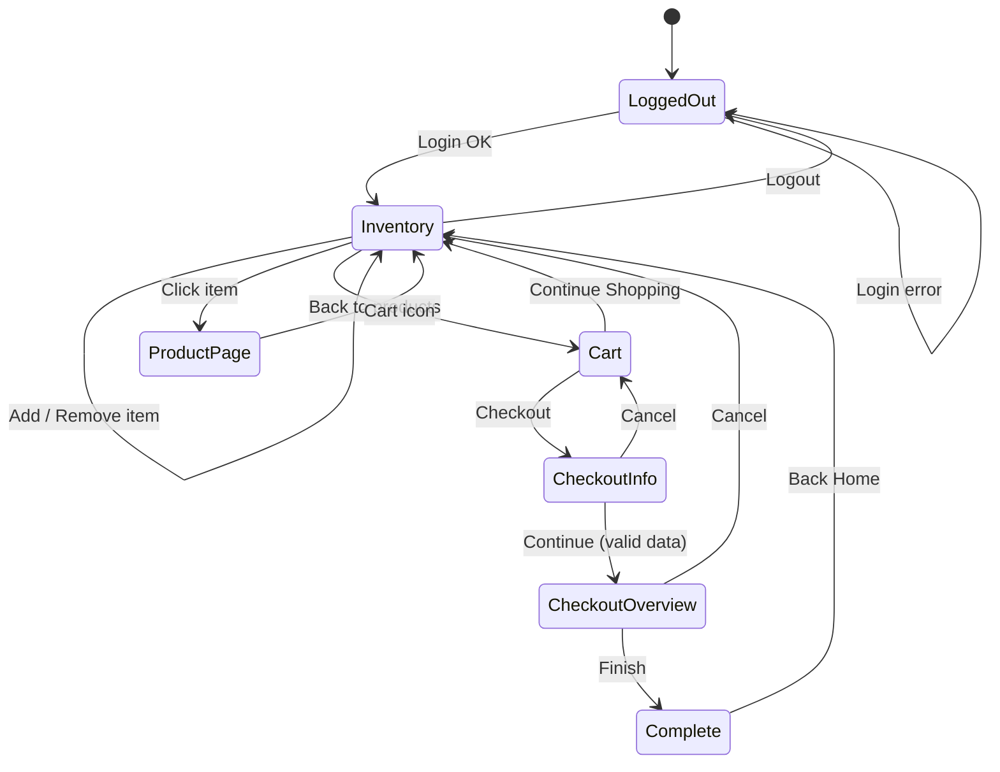

# Тест-дизайн

Документ показывает, **как** были получены тест-кейсы: какие техники применялись и к каким функциям.

---

## 1. Классы эквивалентности (EP) - форма авторизации

| Поле | Валидные классы | Невалидные классы |
|---|---|---|
| Username | Существующий логин из списка (`standard_user`…) | Пустое значение; несуществующий логин; логин в другом регистре (`Standard_User`); логин с пробелами по краям; SQL/HTML-инъекция (`' OR 1=1--`, `<script>`) |
| Password | `secret_sauce` | Пустое значение; неверный пароль; верный пароль в другом регистре |

Из каждого класса берётся одно значение → TC-01…TC-06.

## 2. Граничные значения (BVA) - поле Zip/Postal Code (Checkout)

Требований нет, поэтому за ориентир взят формат почтового индекса США (5 цифр) и РФ (6 цифр).

| Значение | Длина | Ожидание |
|---|---|---|
| `` (пусто) | 0 | Ошибка «Postal Code is required» |
| `1` | 1 | Ошибка формата (по UX-ожиданиям) |
| `1234` | 4 | Ошибка формата |
| `12345` | 5 | Принимается |
| `123456` | 6 | Принимается |
| `1234567` | 7 | Ошибка формата |
| `abcde` | 5 | Ошибка формата - **фактически принимается → BUG-007** |

## 3. Таблица решений - шаг Checkout: Your Information

| Условие | R1 | R2 | R3 | R4 | R5 | R6 | R7 | R8 |
|---|---|---|---|---|---|---|---|---|
| First Name заполнено | Y | N | Y | Y | N | N | Y | N |
| Last Name заполнено | Y | Y | N | Y | N | Y | N | N |
| Postal Code заполнено | Y | Y | Y | N | Y | N | N | N |
| **Результат** | Переход на Overview | Error: First Name | Error: Last Name | Error: Postal Code | Error: First Name | Error: First Name | Error: Last Name | Error: First Name |

Вывод: приложение проверяет поля **по порядку** и показывает только первую ошибку. Это зафиксировано как поведение (не дефект), но отмечено в отчёте как UX-замечание.

## 4. Диаграмма состояний - жизненный цикл заказа

Тест-кейсы покрывают все переходы (state coverage 100%, transition coverage 100%) + недопустимый переход `Cart (пустая) → CheckoutInfo → Complete` (**BUG-005**).

## 5. Pairwise - кроссбраузерность и адаптив

Параметры: Браузер (Chrome, Firefox, Edge) × Разрешение (1920×1080, 1366×768, 768×1024, 375×812) × Пользователь (standard, visual).
Полный перебор: 3 × 4 × 2 = **24** комбинации. Pairwise (все пары): **12** комбинаций.

| # | Браузер | Разрешение | Пользователь |
|---|---|---|---|
| 1 | Chrome | 1920×1080 | standard |
| 2 | Chrome | 1366×768 | visual |
| 3 | Chrome | 768×1024 | standard |
| 4 | Chrome | 375×812 | visual |
| 5 | Firefox | 1920×1080 | visual |
| 6 | Firefox | 1366×768 | standard |
| 7 | Firefox | 768×1024 | visual |
| 8 | Firefox | 375×812 | standard |
| 9 | Edge | 1920×1080 | standard |
| 10 | Edge | 1366×768 | visual |
| 11 | Edge | 768×1024 | standard |
| 12 | Edge | 375×812 | visual |

Экономия: 50% комбинаций без потери покрытия пар.

## 6. Тест-дизайн для API (Restful Booker)

| Эндпоинт | Позитивные проверки | Негативные проверки |
|---|---|---|
| `POST /auth` | Валидные креды → 200 + token | Неверные креды → ожидается 401 (**BUG-010**) |
| `POST /booking` | Валидное тело → 200, bookingid, тело совпадает с запросом | Тело без обязательных полей → ожидается 400 (**BUG-011**) |
| `GET /booking/{id}` | Существующий id → 200 + схема | Несуществующий id → 404 |
| `PUT /booking/{id}` | С токеном → 200, данные обновлены | Без токена → 403 |
| `PATCH /booking/{id}` | Частичное обновление полей | - |
| `DELETE /booking/{id}` | С токеном → ожидается 200/204 (**BUG-009**: 201), затем GET → 404 | - |
