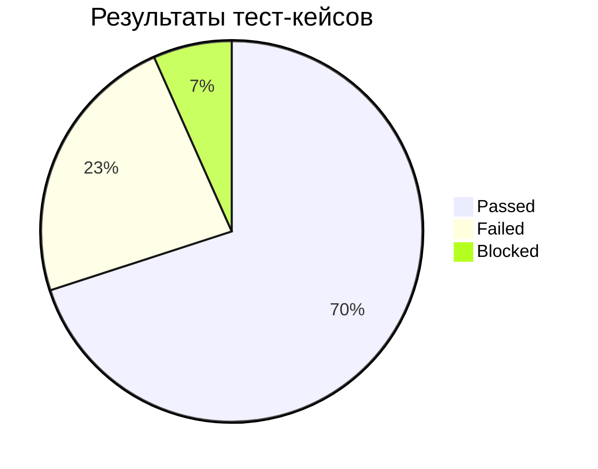
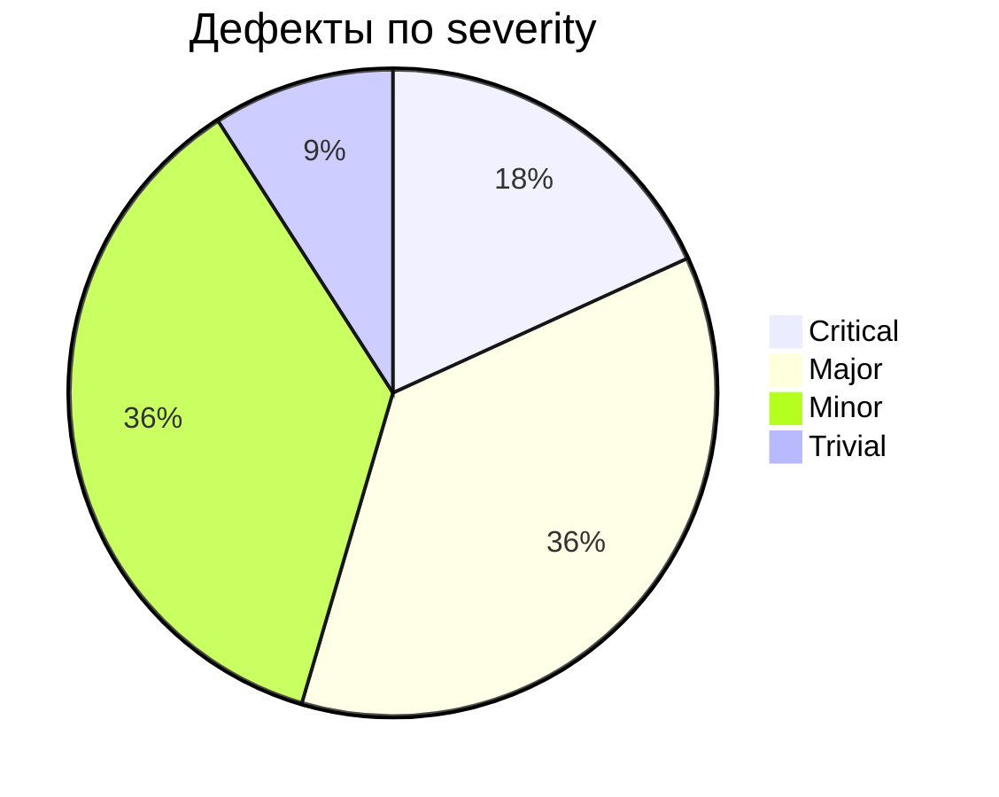

# Test Summary Report

**Проект:** Swag Labs (Web) + Restful Booker (API)
**Автор:** [Имя], QA Engineer
**Окружение:** Windows 11 · Chrome / Firefox / Edge (последние стабильные) · Postman, Newman

---

## 1. Итог в одном абзаце

Основной сценарий покупки под эталонным пользователем (`standard_user`) **работает** во всех трёх браузерах и на всех проверенных разрешениях. Найдено **11 дефектов**, из них **2 Critical** блокируют покупку для отдельных типов пользователей. Для `standard_user` найден 1 Major (оформление заказа с пустой корзиной) - рекомендуется исправить до релиза. API выполняет CRUD корректно, но нарушает REST-конвенции по статус-кодам и падает с 500 на невалидном вводе.

**Рекомендация:** ❌ Не готово к релизу до исправления BUG-001, BUG-002, BUG-005.

## 2. Выполнение тест-кейсов (UI)

| Статус | Кол-во | % |
|---|---|---|
| ✅ Passed | 21 | 70% |
| ❌ Failed | 7 | 23% |
| ⛔ Blocked | 2 | 7% |
| **Всего** | **30** | 100% |

High-приоритет: 17 кейсов, выполнено 100%, Failed - 3 (TC-25, TC-27, TC-29).

## 3. Чек-лист

77 проверок: ✅ 66 · ❌ 8 · ⚠️ 3 (UX-замечания, не дефекты).

## 4. API

| Метрика | Значение |
|---|---|
| Запросов | 14 |
| Автопроверок | 41 |
| Упало (ожидаемо, по багам) | 4 проверки в 3 запросах |
| Эндпоинты | `/ping`, `/auth`, `/booking`, `/booking/{id}` (GET, POST, PUT, PATCH, DELETE) |

## 5. Дефекты

| Severity | Кол-во | ID |
|---|---|---|
| Critical | 2 | BUG-001, BUG-002 |
| Major | 4 | BUG-003, BUG-004, BUG-005, BUG-011 |
| Minor | 4 | BUG-006, BUG-007, BUG-008, BUG-010 |
| Trivial | 1 | BUG-009 |
| **Всего** | **11** | |

**По модулям:** Checkout - 4, Products - 2, Cart - 1, Login - 1, Menu - 1, API - 3.
**Как найдены:** по тест-кейсам - 7, исследовательское тестирование - 1 (BUG-008), API-коллекция - 3.

## 6. Покрытие

| Модуль | Покрыт | Комментарий |
|---|---|---|
| Login | ✅ | Все 6 пользователей, негативные кейсы, базовая безопасность |
| Products | ✅ | Сортировка (4 варианта), карточка, добавление/удаление |
| Cart | ✅ | |
| Checkout | ✅ | Таблица решений по полям, BVA для индекса, расчёт налога |
| Menu / Footer | ✅ | Через чек-лист |
| Кроссбраузерность | ✅ | Chrome, Firefox, Edge |
| Адаптив | ✅ | 4 разрешения, pairwise - 12 комбинаций |
| API | ✅ | CRUD + негатив |

## 7. UX-замечания (не дефекты)

1. Форма Checkout показывает только первую ошибку валидации, а не все сразу.
2. Поля формы принимают строку из одних пробелов.
3. Сессия хранится в cookie на клиенте без серверной проверки (для учебного стенда допустимо, для продакшена - риск).

## 8. Риски и ограничения

- Формальных требований нет - ожидаемые результаты основаны на поведении `standard_user` и общепринятых практиках.
- API-стенд общий и периодически сбрасывается - тесты создают собственные данные.
- Нагрузочное тестирование не проводилось.
